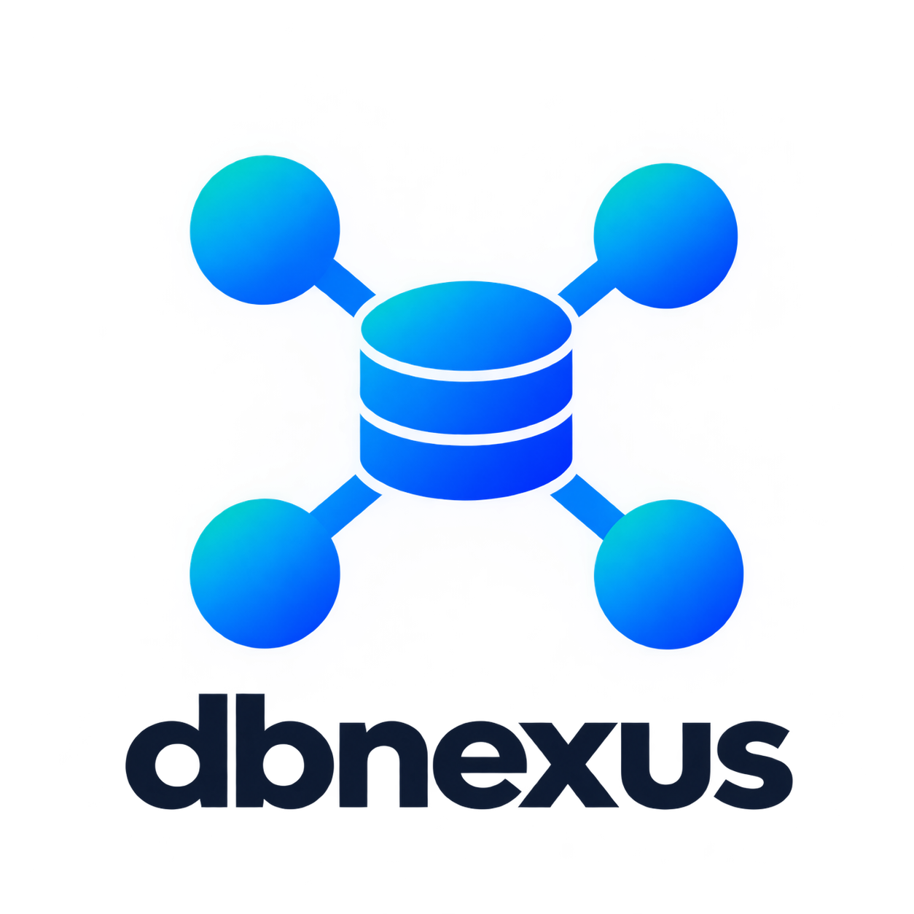

English | [中文](README_CN.md)

<div align="center">



[](https://www.rust-lang.org/) [](https://www.rust-lang.org/) [](https://crates.io/crates/dbnexus) [](https://docs.rs/dbnexus) [](https://crates.io/crates/dbnexus) [](https://github.com/Kirky-X/dbnexus/actions/workflows/ci.yml) [](https://codecov.io/gh/Kirky-X/dbnexus) [](LICENSE)

**Enterprise-grade Database Abstraction Layer for Rust**

[✨ Features](#-features) • [🚀 Quick Start](#-quick-start) • [📚 Documentation](#-documentation) • [💻 Examples](#-examples) • [🤝 Contributing](#-contributing)

</div>

---

<div align="center" style="padding: 32px; margin: 24px 0">

### 🗄️ Declarative Multi-Database Access

Define entities with derive macros; connection pooling, permissions, auditing, and caching are built in:

<table style="width:100%; border-collapse: collapse">
<tr><td align="center" width="25%" style="padding: 12px">🛡️<br><b>Security Built In</b><br><span style="color:#64748B">SQL parsing, per-table permissions, injection defense</span></td><td align="center" width="25%" style="padding: 12px">🧩<br><b>Declarative Macros</b><br><span style="color:#64748B">derive macros generate entity and repository boilerplate</span></td><td align="center" width="25%" style="padding: 12px">🌐<br><b>Multi-Database</b><br><span style="color:#64748B">SQLite, PostgreSQL, MySQL, DuckDB, Ladybug, Neo4j</span></td><td align="center" width="25%" style="padding: 12px">📊<br><b>Observable & Reliable</b><br><span style="color:#64748B">connection metrics, retry with backoff, slow-query tracing</span></td></tr>
</table>

</div>

---

## 📋 Table of Contents

<details open>
<summary>Table of Contents</summary>

- [✨ Features](#-features)
- [🚀 Quick Start](#-quick-start)
- [🎨 Feature Flags](#-feature-flags)
- [📚 Documentation](#-documentation)
- [💻 Examples](#-examples)
- [🏗️ Architecture](#️-architecture)
- [🧪 Testing](#-testing)
- [📊 Performance](#-performance)
- [🔒 Security](#-security)
- [🤝 Contributing](#-contributing)
- [📋 Changelog](#-changelog)
- [📄 License](#-license)
- [🙏 Acknowledgments](#-acknowledgments)
- [📞 Contact & Support](#-contact--support)
- [⭐ Star History](#-star-history)

</details>

---

## ✨ Features

DBNexus is built on Sea-ORM and provides a **declarative** database access approach: one macro defines the entity, one permission layer guards every SQL statement, and one set of features tailors the build.

<table style="width:100%; border-collapse: collapse">
<tr>
<td width="50%" style="vertical-align:top; padding: 12px">🔒 <b>Secure by design</b><br><span style="color:#64748B">Unsafe forbidden crate-wide; table-level RBAC covers JOINs and subqueries</span></td>
<td width="50%" style="vertical-align:top; padding: 12px">🧩 <b>Declarative macros</b><br><span style="color:#64748B"><code>#[db_entity]</code> generates permission-checked CRUD methods</span></td>
</tr>
<tr>
<td width="50%" style="vertical-align:top; padding: 12px">🗄️ <b>Multi-database</b><br><span style="color:#64748B">SQLite / PostgreSQL / MySQL / DuckDB / Ladybug / Neo4j</span></td>
<td width="50%" style="vertical-align:top; padding: 12px">📊 <b>Observable &amp; reliable</b><br><span style="color:#64748B">Prometheus metrics, health checks, retry and circuit breaker</span></td>
</tr>
<tr>
<td width="50%" style="vertical-align:top; padding: 12px">🔄 <b>Connection pool &amp; transactions</b><br><span style="color:#64748B">RAII-style connection lifecycle, pool state maintained with atomics; <code>begin_transaction</code> / <code>commit</code> / rollback for full transaction management</span></td>
<td width="50%" style="vertical-align:top; padding: 12px">🧾 <b>Unified error system</b><br><span style="color:#64748B"><code>ErrorCode</code> table + <code>QueryErrorReport</code> structured error reporting</span></td>
</tr>
<tr>
<td width="50%" style="vertical-align:top; padding: 12px">⚙️ <b>Configuration</b><br><span style="color:#64748B"><code>DbConfig</code> / <code>PoolConfig</code>, environment variable / YAML / TOML multi-source</span></td>
<td width="50%" style="vertical-align:top; padding: 12px">🌍 <b>Internationalization</b><br><span style="color:#64748B">ICU4X + Fluent locale-aware formatting (core feature, always compiled)</span></td>
</tr>
<tr>
<td width="50%" style="vertical-align:top; padding: 12px">🛡️ <b>Permission control</b><br><span style="color:#64748B"><code>permission</code>: role-based table-level access control (RBAC), hard-depends on <code>sql-parser</code> to prevent injection bypass</span></td>
<td width="50%" style="vertical-align:top; padding: 12px">🔍 <b>SQL parsing</b><br><span style="color:#64748B"><code>sql-parser</code>: operation type and table extraction, injection detection, cached parse results</span></td>
</tr>
<tr>
<td width="50%" style="vertical-align:top; padding: 12px">📦 <b>Procedural macros &amp; env config</b><br><span style="color:#64748B"><code>macros</code> provides <code>#[db_repository]</code> and other macros; <code>config-env</code> supports <code>DbConfig::from_env</code> to read env vars directly</span></td>
<td width="50%" style="vertical-align:top; padding: 12px">🏢 <b>Enterprise features on demand</b><br><span style="color:#64748B">metrics / audit / migration / sharding / authentication / saga and 20+ feature-gated options, see the link below for the complete list</span></td>
</tr>
</table>

The core foundation (no optional-feature dependencies) and the `default-no-db` aggregate capabilities are already listed in the table above; the remaining enterprise features (metrics / audit / migration / sharding / cache / authentication / saga and 20+ items) are all feature-gated and enabled on demand — for the complete list, see [User Guide · Enterprise Features Complete List](docs/en/USER_GUIDE.md#-enterprise-features-complete-list-opt-in).

---

## 🚀 Quick Start

### 📦 Installation

Requirements: Rust **1.97.1+** (pinned by `rust-toolchain.toml`, edition 2024), plus at least one runtime and one database driver feature.

<details>
<summary>📄 Code · bash</summary>

```bash
cargo add dbnexus --features runtime-tokio-rustls,sqlite,permission,macros
cargo add tokio --features rt-multi-thread,macros
```

</details>

<details>
<summary>📄 Code · toml</summary>

```toml
[dependencies]
dbnexus = { version = "0.6.1", features = ["runtime-tokio-rustls", "sqlite", "permission", "macros"] }
tokio = { version = "1", features = ["rt-multi-thread", "macros"] }
```

</details>

> `permission` force-enables `sql-parser` and `cache` (prevents SQL injection bypassing permission checks; `cache` is the explicit dependency of the permission policy cache). `default = []`: every feature must be enabled explicitly.

### 💡 Minimal Example

Define an entity and get macro-generated CRUD (adapted from [examples/src/basic/basic_crud.rs](examples/src/basic/basic_crud.rs); `ActiveModelBehavior` is implemented by the macro):

<details>
<summary>📄 Code · rust</summary>

```rust
use dbnexus::{DbPool, db_entity};
use dbnexus::sea_orm::entity::prelude::*;

#[db_entity(table_name = "users", primary_key = "id")]
#[derive(Clone, Debug, PartialEq, DeriveEntityModel)]
#[sea_orm(table_name = "users")]
pub struct Model {
    #[sea_orm(primary_key)]
    pub id: i64,
    pub name: String,
    pub email: String,
}

#[derive(Copy, Clone, Debug, EnumIter, DeriveRelation)]
pub enum Relation {}

#[tokio::main]
async fn main() -> Result<(), Box<dyn std::error::Error>> {
    // Pool + admin session (RAII: the connection returns to the pool on drop)
    let pool = DbPool::new("sqlite::memory:").await?;
    let session = pool.get_session("admin").await?;

    // Create the table (DDL is admin-only; macro-generated CRUD does not create tables)
    session
        .execute_raw_ddl("CREATE TABLE users (id INTEGER PRIMARY KEY, name TEXT, email TEXT)")
        .await?;

    // Macro-generated CRUD: every statement goes through parsing and table-level permission checks
    let user = Model { id: 1, name: "Alice".to_string(), email: "alice@example.com".to_string() };
    Model::insert(&session, user).await?;

    let users = Model::find_all(&session).await?;
    println!("Found {} users", users.len());
    Ok(())
}
```

</details>

For permission-denial behavior (unauthorized roles and unauthorized tables are both denied) and permission policy configuration, see [User Guide · Permission Control](docs/en/USER_GUIDE.md#-permission-control); for the full explanation of the core concepts (`DbPool` / `Session` / `#[db_entity]` / permission policy / feature gating), see the [User Guide](docs/en/USER_GUIDE.md).

---

## 🎨 Feature Flags

`default = []`: no default features; runtime, database driver and functional features must all be enabled explicitly; embedded (`sqlite`/`duckdb`) and server-side (`postgres`/`mysql`) drivers are strictly mutually exclusive at compile time. For all flags and presets — runtimes, drivers, core capabilities, data access, observability, data management, distributed capabilities, security and compliance — see [User Guide · Feature Flags Reference](docs/en/USER_GUIDE.md#feature-flags-reference).

### MCP tool surface (`mcp`)

`dbnexus-cli mcp-serve` starts a stdio MCP server whose tools are bound to the permission engine: `dbnexus_query` (whitelisted table/columns, filters and bounded pagination via `DataApiGateway`), `dbnexus_schema` (declared endpoint metadata only), and `dbnexus_explain` (permission-check preview, no SQL execution). The execution role and endpoints are configured through `DBNEXUS_MCP_*` environment variables; a missing role is fail-closed.

### Security posture self-audit

Run `dbnexus-cli doctor` to report which security features are compiled into the current build (JSON output).
`--profile production` judges the Required checks (`rbac`, `injection-detection`); exit code 0 means compliant, 1 means a Required check is missing, and 2 means a usage error.

| Check ID | Feature | Severity |
|---|---|---|
| `rbac` | `permission` | Required |
| `injection-detection` | `sql-parser` | Required |
| `policy-cache` | `cache` | Recommended |
| `rls-and-masking` | `data-protection` | Recommended |
| `pdp` | `permission-engine` | Info |
| `unified-facade` | `permission-facade` | Info |
| `audit` | `audit` | Recommended |
| `jwt-auth` | `authentication` | Recommended |
| `drivers` | any relational driver | Info |

The library API `dbnexus::security_posture(profile)` returns the same report for embedding in deployment checks.

---

## 📚 Documentation

<details>
<summary>📋 Table</summary>

| Document | Description |
|------|------|
| [📖 User Guide](docs/en/USER_GUIDE.md) | Complete tutorial from installation to advanced usage |
| [📘 API Reference](docs/en/API_REFERENCE.md) | Detailed description of all public APIs |
| [🏗️ Architecture](docs/en/ARCHITECTURE.md) | Design philosophy, module breakdown, data flow, security/performance design |
| [⛔ Rate Limiting & Migration](docs/en/RATE_LIMITING.md) | `dbnexus-limiter-port` topology, token-bucket vs. external backend selection, and the 403/429 semantics migration |
| [📊 Performance Baseline](docs/en/PERFORMANCE.md) | End-to-end benchmark data and reproduction commands |
| [🔒 Security](docs/en/SECURITY.md) | Defense-in-depth design, best practices and vulnerability reporting |
| [📋 Changelog](docs/en/CHANGELOG.md) | Change records for every version |
| [🤝 Contributing](docs/en/CONTRIBUTING.md) | TDD workflow, code conventions, commit/PR process |
| [🧪 Test Scenarios](docs/en/TEST_SCENARIOS.md) | Test pyramid baseline, driver-group matrix and E2E scenarios |
| [📦 Online API Docs](https://docs.rs/dbnexus) | Latest documentation auto-generated by docs.rs |
| [📦 crates.io](https://crates.io/crates/dbnexus) | Release page |

</details>

---

## 💻 Examples

All examples live in [examples/](examples/) (a separate crate `dbnexus-examples`, managed in the workspace), **52 binary targets** in total (as of 0.6.1). For run commands, the per-module listing and the `graph_ladybug` limitation, see [examples/README.md](examples/README.md); for more configuration, transaction and monitoring snippets, see the [User Guide](docs/en/USER_GUIDE.md) and the [API Reference](docs/en/API_REFERENCE.md).

---

## 🏗️ Architecture

DBNexus follows a layered module design: `foundation` provides the config and error base; the `database` module hosts the connection pool, Session, migrations, sharding, Saga and scatter-gather; the `access` module concentrates SQL parsing, the permission engine, authentication and masking; the `domain` module holds domain abstractions for permission/audit/migration; `observability` and `reliability` provide metrics/health and retry/failover respectively. All optional capabilities are trimmed at compile time via feature gates, and the `dbnexus-macros` proc-macro crate generates permission-checked CRUD code for entities at compile time. The layered design, per-layer responsibilities and the full module overview are detailed in [Architecture · System Architecture](docs/en/ARCHITECTURE.md#system-architecture).

### 🔗 Core Execution Path

Under the `sql-parser` + `permission` feature combination, `Session::execute_raw` runs through the "reject DDL → parse → per-table permission check → driver execution" pipeline, with non-admin roles failing closed (missing or invalid table names are rejected, and every target table in JOINs / subqueries is checked), while `retry` / `metrics` / `audit` all hook into this pipeline. See [Architecture · Core Execution Pipeline](docs/en/ARCHITECTURE.md#core-execution-pipeline) for the full sequence diagram and path notes.

### 🌐 Database Support

<details>
<summary>📋 Table</summary>

| Driver feature | Database | Type | Introduced |
|----------|--------|------|----------|
| `sqlite` | SQLite | Embedded relational | Initial |
| `postgres` | PostgreSQL | Server relational | Initial |
| `mysql` | MySQL | Server relational | Initial |
| `duckdb` | DuckDB | Embedded analytical | 0.3.0 |
| `ladybug` | Ladybug (formerly Kuzu) | Embedded graph | 0.4.0 |
| `neo4j` | Neo4j | Graph server | 0.4.0 |

</details>

Protocol-compatible databases (no extra feature needed, just use the corresponding protocol driver):

| Database | Compatible Protocol | Description |
|--------|----------|------|
| CockroachDB | PostgreSQL | Distributed SQL database |
| YugabyteDB | PostgreSQL | Distributed PostgreSQL |
| TiDB | MySQL | Distributed HTAP database |
| MariaDB | MySQL | MySQL-compatible fork |
| Aurora | PostgreSQL/MySQL | AWS cloud-native database |

> Known limitation: enabling `duckdb` and `ladybug` together hits a duplicate-symbol link conflict — each driver bundles its own vendored mbedtls static library. A compile-time mutex guard now rejects the combination outright with grouping guidance (`ladybug` + `sqlite` stays allowed); verify multiple drivers with grouped feature combinations.

---

## 🧪 Testing

Tests are carried by six layers: `src/**` unit tests, `tests/**` integration targets, `tests/e2e/` end-to-end scenarios, `postgres/mysql_testcontainers` container-level tests, doc tests, and [benches/](benches/) benchmarks; the scale is 2873 test functions and 87 test targets, with a line-coverage gate of ≥ 95%. For the test pyramid baseline, driver-group matrix and E2E scenario definitions, see [Test Scenarios](docs/en/TEST_SCENARIOS.md) (scale data in [Test Scale](docs/en/TEST_SCENARIOS.md#test-scale-as-of-061)); for run commands, see [Contributing · Testing Conventions](docs/en/CONTRIBUTING.md#-testing-conventions).

---

## 📊 Performance

DBNexus follows the zero-cost abstraction principle: compile-time feature-gate trimming, lock-free hot paths (pool state via atomics, permission config and cache read via lock-free `ArcSwap`, `AcqRel` ordering), async-first I/O, and pool strategy (LRU reuse, max-connection limits, minimum-connection warmup, health checks evicting dead connections). For the benchmark infrastructure (9 criterion benchmarks under [benches/](benches/)), the end-to-end baseline and the historical optimization comparison, see the [Performance Baseline](docs/en/PERFORMANCE.md).

---

## 🔒 Security

DBNexus is built with security in mind; its defense-in-depth design spans five layers from the bottom up: compile-time guarantees (crate-wide `#![forbid(unsafe_code)]`, driver mutual exclusion via `compile_error!`), runtime table-level RBAC (JOIN/subquery coverage, TTL permission cache + singleflight, token-bucket rate limiting), injection defense (parameterized queries by default, `SqlParser` table extraction + the unified injection engine, `DdlGuard` AST validation with DDL restricted to admin), authentication and configuration security (distinct JWT access/refresh token validation, bcrypt password policy, path-traversal validation), and audit & masking (admin bypasses recorded as well, `SensitiveMasker`); supply-chain security is guaranteed by CI-always-on `cargo deny check` and `cargo audit`, CodeQL, Dependabot, and pre-commit private-key scanning. For the full design, see the [Security document](docs/en/SECURITY.md).

**Vulnerability reporting**: please do not report through public issues. Use the private GitHub [Security Advisories](https://github.com/Kirky-X/dbnexus/security/policy) channel ("Report a vulnerability"). Response commitment: acknowledgment within 48 hours, initial assessment within 7 days.

---

## 🤝 Contributing

Contributions are welcome! Please read [CONTRIBUTING.md](docs/en/CONTRIBUTING.md) first for the TDD workflow, the development environment requirements (Rust 1.97.1 toolchain, lefthook / pre-commit hooks — install with `lefthook install` or `pip install pre-commit && pre-commit install`, bypassing with `--no-verify` is forbidden, Conventional Commits commit messages) and the quality gates (`cargo fmt --check`, `cargo clippy -D warnings`, `cargo deny check`, `cargo audit`, ≥ 95% line coverage), as well as the commit/PR process.

---

## 📋 Changelog

See [CHANGELOG.md](docs/en/CHANGELOG.md) for the full version history.

---

## 📄 License

This project is licensed under the [MIT](LICENSE) License.

Copyright (c) 2025-2026 Kirky.X🌠

---

## 🙏 Acknowledgments

- [Sea-ORM](https://www.sea-ql.org/SeaORM/) - The excellent ORM framework DBNexus is built on
- [SQLx](https://github.com/launchbadge/sqlx) - Async SQL toolkit
- [sqlparser](https://github.com/apache/datafusion-sqlparser-rs) - SQL dialect parsing powering permission checks and injection defense
- [ICU4X](https://github.com/unicode-org/icu4x) - Unicode internationalization components powering locale-aware formatting
- The Rust community for amazing tools and libraries

---

## 📞 Contact & Support

| Channel | Purpose |
|---------|---------|
| [📋 Issues](https://github.com/Kirky-X/dbnexus/issues) | Report bugs and issues |
| [💬 Discussions](https://github.com/Kirky-X/dbnexus/discussions) | Ask questions and share ideas |
| [🐙 GitHub](https://github.com/Kirky-X/dbnexus) | View source code |

Please do not report security vulnerabilities through public issues; see the [vulnerability reporting process](docs/en/SECURITY.md) in the Security document.

---

## ⭐ Star History

[](https://star-history.com/#Kirky-X/dbnexus&Date)

### 💝 Support This Project

If you find this project useful, please consider giving it a ⭐️!

---

<div align="center">

**Built with ❤️ by Kirky.X**

[⬆ Back to Top](#-table-of-contents)

<sub>© 2026 Kirky.X. All rights reserved.</sub>

</div>
