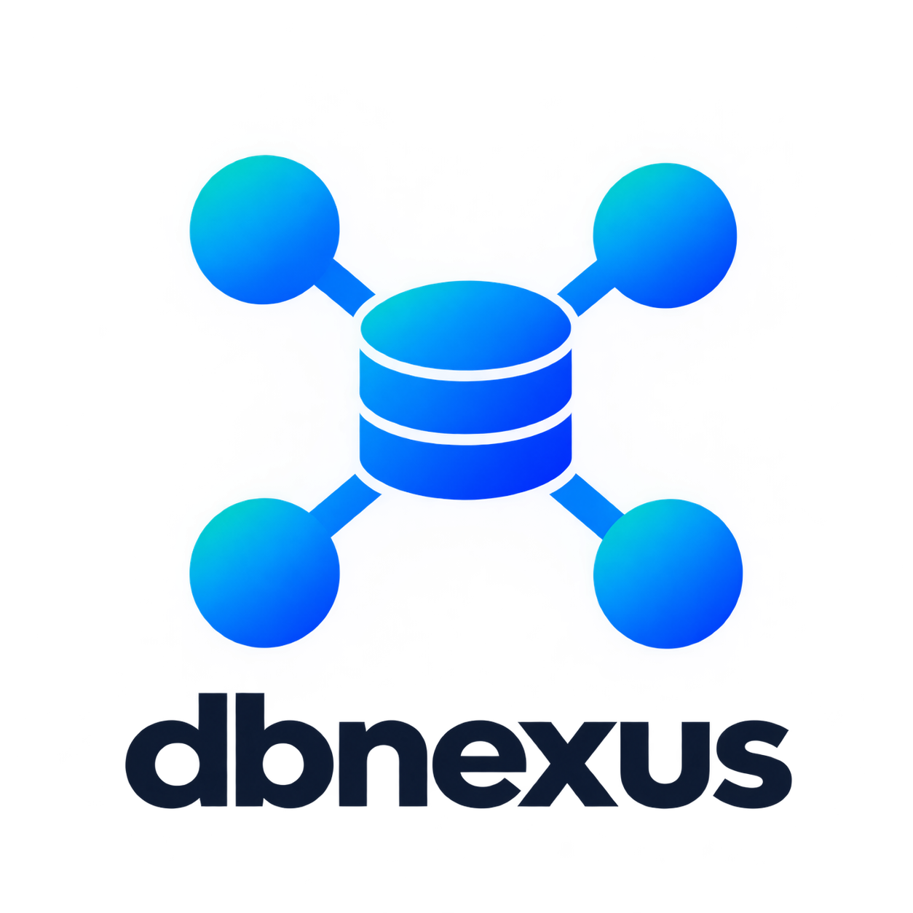

[English](README.md) | 中文

<div align="center">



[](https://www.rust-lang.org/) [](https://www.rust-lang.org/) [](https://crates.io/crates/dbnexus) [](https://docs.rs/dbnexus) [](https://crates.io/crates/dbnexus) [](https://github.com/Kirky-X/dbnexus/actions/workflows/ci.yml) [](https://codecov.io/gh/Kirky-X/dbnexus) [](LICENSE)

**企业级 Rust 数据库抽象层**

[✨ 功能特性](#-功能特性) • [🚀 快速开始](#-快速开始) • [📚 文档](#-文档) • [💻 示例](#-示例) • [🤝 参与贡献](#-参与贡献)

</div>

---

<div align="center" style="padding: 32px; margin: 24px 0">

### 🗄️ 声明式多数据库访问

通过派生宏定义实体，连接池、权限、审计与缓存由框架内建：

<table style="width:100%; border-collapse: collapse">
<tr><td align="center" width="25%" style="padding: 12px">🛡️<br><b>安全内建</b><br><span style="color:#64748B">SQL 解析 逐表权限 注入防护</span></td><td align="center" width="25%" style="padding: 12px">🧩<br><b>声明式宏</b><br><span style="color:#64748B">派生宏生成实体与仓储样板</span></td><td align="center" width="25%" style="padding: 12px">🌐<br><b>多数据库</b><br><span style="color:#64748B">SQLite PostgreSQL MySQL DuckDB Ladybug Neo4j</span></td><td align="center" width="25%" style="padding: 12px">📊<br><b>可观测可靠</b><br><span style="color:#64748B">连接指标 熔断重试 慢查询追踪</span></td></tr>
</table>

</div>

---

## 📋 目录

<details open>
<summary>📑 目录</summary>

- [✨ 功能特性](#-功能特性)
- [🚀 快速开始](#-快速开始)
- [🎨 特性标志](#-特性标志)
- [📚 文档](#-文档)
- [💻 示例](#-示例)
- [🏗️ 架构](#️-架构)
- [🧪 测试](#-测试)
- [📊 性能](#-性能)
- [🔒 安全](#-安全)
- [🤝 参与贡献](#-参与贡献)
- [📋 更新日志](#-更新日志)
- [📄 许可证](#-许可证)
- [🙏 致谢](#-致谢)
- [📞 联系与支持](#-联系与支持)
- [⭐ Star 历史](#-star-历史)

</details>

---

## ✨ 功能特性

DBNexus 基于 Sea-ORM 构建，提供一种**声明式**的数据库访问方式：一个宏定义实体，一层权限守住每条 SQL，一组特性按需裁剪。

<table style="width:100%; border-collapse: collapse">
<tr>
<td width="50%" style="vertical-align:top; padding: 12px">🔒 <b>安全内建</b><br><span style="color:#64748B">全库禁用 unsafe，表级 RBAC 覆盖 JOIN 与子查询</span></td>
<td width="50%" style="vertical-align:top; padding: 12px">🧩 <b>声明式宏</b><br><span style="color:#64748B"><code>#[db_entity]</code> 生成带权限检查的 CRUD 方法</span></td>
</tr>
<tr>
<td width="50%" style="vertical-align:top; padding: 12px">🗄️ <b>多数据库</b><br><span style="color:#64748B">SQLite / PostgreSQL / MySQL / DuckDB / Ladybug / Neo4j</span></td>
<td width="50%" style="vertical-align:top; padding: 12px">📊 <b>可观测可靠</b><br><span style="color:#64748B">Prometheus 指标、健康检查、重试与熔断</span></td>
</tr>
<tr>
<td width="50%" style="vertical-align:top; padding: 12px">🔄 <b>连接池与事务</b><br><span style="color:#64748B">RAII 风格连接生命周期、池状态原子维护；<code>begin_transaction</code> / <code>commit</code> / 回滚完整事务管理</span></td>
<td width="50%" style="vertical-align:top; padding: 12px">🧾 <b>统一错误体系</b><br><span style="color:#64748B"><code>ErrorCode</code> 错误码表 + <code>QueryErrorReport</code> 结构化错误报告</span></td>
</tr>
<tr>
<td width="50%" style="vertical-align:top; padding: 12px">⚙️ <b>配置管理</b><br><span style="color:#64748B"><code>DbConfig</code> / <code>PoolConfig</code>，环境变量 / YAML / TOML 多配置源</span></td>
<td width="50%" style="vertical-align:top; padding: 12px">🌍 <b>国际化</b><br><span style="color:#64748B">ICU4X + Fluent locale 感知格式化（核心特性，始终编译）</span></td>
</tr>
<tr>
<td width="50%" style="vertical-align:top; padding: 12px">🛡️ <b>权限控制</b><br><span style="color:#64748B"><code>permission</code>：基于角色的表级访问控制（RBAC），强制依赖 <code>sql-parser</code> 防止注入绕过</span></td>
<td width="50%" style="vertical-align:top; padding: 12px">🔍 <b>SQL 解析</b><br><span style="color:#64748B"><code>sql-parser</code>：操作类型与表名提取、注入检测，解析结果缓存</span></td>
</tr>
<tr>
<td width="50%" style="vertical-align:top; padding: 12px">📦 <b>过程宏与环境变量配置</b><br><span style="color:#64748B"><code>macros</code> 提供 <code>#[db_repository]</code> 等宏；<code>config-env</code> 支持 <code>DbConfig::from_env</code> 直读环境变量</span></td>
<td width="50%" style="vertical-align:top; padding: 12px">🏢 <b>企业级特性按需装配</b><br><span style="color:#64748B">metrics / audit / migration / sharding / authentication / saga 等 20+ 特性门控启用，完整清单见下方链接</span></td>
</tr>
</table>

核心基座（无可选特性依赖）与 `default-no-db` 聚合能力已列入上表；其余企业级特性（metrics / audit / migration / sharding / cache / authentication / saga 等 20+ 项）均按 feature 门控、按需启用，完整清单见[用户指南 · 企业级特性完整清单](docs/cn/USER_GUIDE.md#-企业级特性完整清单按需启用)。

---

## 🚀 快速开始

### 📦 安装

要求：Rust **1.97.1+**（`rust-toolchain.toml` 锁定，edition 2024），并至少启用一个运行时与一个数据库驱动特性。

<details>
<summary>📄 代码 · bash</summary>

```bash
cargo add dbnexus --features runtime-tokio-rustls,sqlite,permission,macros
cargo add tokio --features rt-multi-thread,macros
```

</details>

<details>
<summary>📄 代码 · toml</summary>

```toml
[dependencies]
dbnexus = { version = "0.6.0", features = ["runtime-tokio-rustls", "sqlite", "permission", "macros"] }
tokio = { version = "1", features = ["rt-multi-thread", "macros"] }
```

</details>

> `permission` 会强制启用 `sql-parser` 与 `cache`（防 SQL 注入绕过权限检查；`cache` 为权限策略缓存的显式依赖）。`default = []`：所有特性均需显式启用。

### 💡 最小示例

定义实体并获得宏生成的 CRUD（改编自 [examples/src/basic/basic_crud.rs](examples/src/basic/basic_crud.rs)，`ActiveModelBehavior` 由宏自动实现）：

<details>
<summary>📄 代码 · rust</summary>

```rust
use dbnexus::{DbPool, db_entity};
use dbnexus::sea_orm::entity::prelude::*;

#[db_entity(table_name = "users", primary_key = "id")]
#[derive(Clone, Debug, PartialEq, DeriveEntityModel)]
#[sea_orm(table_name = "users")]
pub struct Model {
    #[sea_orm(primary_key)]
    pub id: i64,
    pub name: String,
    pub email: String,
}

#[derive(Copy, Clone, Debug, EnumIter, DeriveRelation)]
pub enum Relation {}

#[tokio::main]
async fn main() -> Result<(), Box<dyn std::error::Error>> {
    // 连接池 + admin 会话（RAII：Session 丢弃时连接自动归还）
    let pool = DbPool::new("sqlite::memory:").await?;
    let session = pool.get_session("admin").await?;

    // 建表（DDL 仅限 admin 角色；宏生成的 CRUD 不含建表逻辑）
    session
        .execute_raw_ddl("CREATE TABLE users (id INTEGER PRIMARY KEY, name TEXT, email TEXT)")
        .await?;

    // 宏生成的 CRUD：每条语句都经过解析与表级权限检查
    let user = Model { id: 1, name: "Alice".to_string(), email: "alice@example.com".to_string() };
    Model::insert(&session, user).await?;

    let users = Model::find_all(&session).await?;
    println!("找到 {} 个用户", users.len());
    Ok(())
}
```

</details>

权限拒绝行为（未授权角色与未授权表均被拒）与权限策略配置见[用户指南 · 权限控制](docs/cn/USER_GUIDE.md#-权限控制)；核心概念（`DbPool` / `Session` / `#[db_entity]` / 权限策略 / 特性门控）的完整说明见[用户指南](docs/cn/USER_GUIDE.md)。

---

## 🎨 特性标志

`default = []`：无任何默认特性，运行时、数据库驱动与功能特性均需显式启用；嵌入式（`sqlite`/`duckdb`）与服务器端（`postgres`/`mysql`）驱动编译期严格互斥。运行时、驱动、核心能力、数据访问、可观测性、数据管理、分布式、安全合规全部标志与特性预设见[用户指南 · 特性标志参考](docs/cn/USER_GUIDE.md#特性标志参考)。

---

## 📚 文档

<details>
<summary>📋 表格</summary>

| 文档 | 说明 |
|------|------|
| [📖 用户指南](docs/cn/USER_GUIDE.md) | 从安装到进阶的完整使用教程 |
| [📘 API 参考](docs/cn/API_REFERENCE.md) | 全部公开 API 的详细说明 |
| [🏗️ 架构文档](docs/cn/ARCHITECTURE.md) | 设计理念、模块划分、数据流与安全/性能设计 |
| [⛔ 限流与迁移指南](docs/cn/RATE_LIMITING.md) | `dbnexus-limiter-port` 端口拓扑、令牌桶/外部后端选型与 403/429 语义迁移 |
| [📊 性能基线](docs/cn/PERFORMANCE.md) | 端到端基准数据与复现命令 |
| [🔒 安全文档](docs/cn/SECURITY.md) | 纵深防御设计、最佳实践与漏洞报告流程 |
| [📋 更新日志](docs/cn/CHANGELOG.md) | 每个版本的变更记录 |
| [🤝 贡献指南](docs/cn/CONTRIBUTING.md) | TDD 工作流、代码规范与提交/PR 流程 |
| [🧪 测试场景固化](docs/cn/TEST_SCENARIOS.md) | 测试金字塔基线、驱动组矩阵与 E2E 场景定义 |
| [📦 在线 API 文档](https://docs.rs/dbnexus) | docs.rs 自动生成的最新文档 |
| [📦 crates.io](https://crates.io/crates/dbnexus) | 发布页面 |

</details>

---

## 💻 示例

全部示例位于 [examples/](examples/)（独立 crate `dbnexus-examples`，随 workspace 管理），共 **52 个二进制目标**（截至 0.6.0）。运行命令、按模块清单与 `graph_ladybug` 限制说明见 [examples/README.md](examples/README.md)；更多配置、事务与监控代码片段见[用户指南](docs/cn/USER_GUIDE.md)与 [API 参考](docs/cn/API_REFERENCE.md)。

---

## 🏗️ 架构

DBNexus 采用分层模块设计：`foundation` 提供配置与错误基座，`database` 模块承载连接池、Session、迁移、分片、Saga 与 scatter-gather，`access` 模块集中 SQL 解析、权限引擎、认证与脱敏，`domain` 模块沉淀权限/审计/迁移的领域抽象，`observability` 与 `reliability` 分别提供指标健康与重试容错。所有可选能力经特性门控编译期裁剪，过程宏 `dbnexus-macros` 在编译期为实体生成带权限检查的 CRUD 代码。分层模块设计、各层职责与模块全景图的详细设计见[架构文档 · 系统架构](docs/cn/ARCHITECTURE.md#系统架构)。

### 🔗 核心执行路径

`Session::execute_raw` 在 `sql-parser` + `permission` 特性组合下经「拒绝 DDL → 解析 → 逐表权限检查 → 驱动执行」管道执行，非 admin 角色 fail-closed（表名提取失败或非法即拒绝，JOIN / 子查询目标表逐一受检），`retry` / `metrics` / `audit` 均挂接于此管道。完整时序图与路径要点见[架构文档 · 核心执行管道](docs/cn/ARCHITECTURE.md#核心执行管道)。

### 🌐 数据库支持

<details>
<summary>📋 表格</summary>

| 驱动特性 | 数据库 | 类型 | 引入版本 |
|----------|--------|------|----------|
| `sqlite` | SQLite | 嵌入式关系型 | 初始 |
| `postgres` | PostgreSQL | 服务器关系型 | 初始 |
| `mysql` | MySQL | 服务器关系型 | 初始 |
| `duckdb` | DuckDB | 嵌入式分析型 | 0.3.0 |
| `ladybug` | Ladybug（原 Kuzu） | 嵌入式图数据库 | 0.4.0 |
| `neo4j` | Neo4j | 图数据库服务器 | 0.4.0 |

</details>

通过标准协议支持的兼容数据库（无需额外特性，使用对应协议驱动即可）：

| 数据库 | 兼容协议 | 说明 |
|--------|----------|------|
| CockroachDB | PostgreSQL | 分布式 SQL 数据库 |
| YugabyteDB | PostgreSQL | 分布式 PostgreSQL |
| TiDB | MySQL | 分布式 HTAP 数据库 |
| MariaDB | MySQL | MySQL 兼容分支 |
| Aurora | PostgreSQL/MySQL | AWS 云原生数据库 |

> 已知限制：`duckdb` 与 `ladybug` 同时启用会因两驱动 bundled 各自 vendor 的 mbedtls 静态库产生重复符号链接冲突，已建编译期互斥守卫（同启用即编译失败并给出分组指引，`ladybug` + `sqlite` 组合不受影响），多驱动验证请采用分组特性组合。

---

## 🧪 测试

测试分六层承载：`src/**` 单元测试、`tests/**` 集成测试目标、`tests/e2e/` 端到端场景、`postgres/mysql_testcontainers` 容器级测试、doc tests 与 [benches/](benches/) 基准；规模 2869 个测试函数、87 个测试目标，行覆盖门禁 ≥ 95%。金字塔基线、驱动组矩阵与 E2E 场景定义见[测试场景固化](docs/cn/TEST_SCENARIOS.md)（规模数据见[测试规模](docs/cn/TEST_SCENARIOS.md#测试规模截至-060)），运行命令见[贡献指南 · 测试规范](docs/cn/CONTRIBUTING.md#-测试规范)。

---

## 📊 性能

DBNexus 遵循零成本抽象原则：特性门控编译期裁剪、无锁热路径（池状态原子维护、权限配置与缓存 `ArcSwap` 无锁读取、`AcqRel` 内存序）、异步优先 I/O、连接池策略（LRU 复用、最大连接限制、最小连接预热、健康检查剔除死连接）。基准设施（9 个 criterion 基准位于 [benches/](benches/)）、端到端基线与历史优化对照见[性能基线](docs/cn/PERFORMANCE.md)。

---

## 🔒 安全

DBNexus 从设计之初就以内建安全为目标，纵深防御自下而上五层：编译时保证（全库 `#![forbid(unsafe_code)]`、驱动互斥 `compile_error!`）、运行时表级 RBAC（JOIN/子查询受检、TTL 权限缓存 + singleflight、令牌桶限流）、注入防护（默认参数化、`SqlParser` 表名提取 + 统一注入引擎、`DdlGuard` AST 校验且 DDL 仅限 admin）、认证与配置安全（JWT 访问/刷新令牌区分校验、bcrypt 密码策略、路径遍历校验）、审计与脱敏（admin 绕过同样记录、`SensitiveMasker`）；供应链安全由 CI 常开的 `cargo deny check` 与 `cargo audit`、CodeQL、Dependabot 及 pre-commit 私钥扫描保障。完整设计见[安全文档](docs/cn/SECURITY.md)。

**漏洞报告**：请勿通过公开 Issue 提交。请使用 GitHub [Security Advisories](https://github.com/Kirky-X/dbnexus/security/policy) 私密通道（"Report a vulnerability"）。响应承诺：48 小时内确认，7 天内给出初步评估。

---

## 🤝 参与贡献

欢迎贡献！请先阅读 [CONTRIBUTING.md](docs/cn/CONTRIBUTING.md)，了解 TDD 工作流、开发环境要求（Rust 1.97.1 工具链、lefthook / pre-commit 钩子——安装方式 `lefthook install` 或 `pip install pre-commit && pre-commit install`，禁止 `--no-verify` 绕过、Conventional Commits 提交信息）与质量门禁（`cargo fmt --check`、`cargo clippy -D warnings`、`cargo deny check`、`cargo audit`、行覆盖 ≥ 95%），以及提交/PR 流程。

---

## 📋 更新日志

完整版本历史见 [CHANGELOG.md](docs/cn/CHANGELOG.md)。

---

## 📄 许可证

本项目基于 [MIT](LICENSE) 许可证发布。

Copyright (c) 2025-2026 Kirky.X🌠

---

## 🙏 致谢

- [Sea-ORM](https://www.sea-ql.org/SeaORM/) - 优秀的 ORM 框架，DBNexus 建立在其上
- [SQLx](https://github.com/launchbadge/sqlx) - 异步 SQL 工具包
- [sqlparser](https://github.com/apache/datafusion-sqlparser-rs) - SQL 方言解析，支撑权限检查与注入防护
- [ICU4X](https://github.com/unicode-org/icu4x) - Unicode 国际化组件，支撑 locale 感知格式化
- Rust 社区提供的优秀工具和库

---

## 📞 联系与支持

| 渠道 | 用途 |
|------|------|
| [📋 Issues](https://github.com/Kirky-X/dbnexus/issues) | 报告 Bug 和问题 |
| [💬 Discussions](https://github.com/Kirky-X/dbnexus/discussions) | 提问和分享想法 |
| [🐙 GitHub](https://github.com/Kirky-X/dbnexus) | 查看源代码 |

安全漏洞请勿通过公开 Issue 提交，参见[安全文档](docs/cn/SECURITY.md)的漏洞报告流程。

---

## ⭐ Star 历史

[](https://star-history.com/#Kirky-X/dbnexus&Date)

### 💝 支持本项目

如果您觉得这个项目有用，请考虑给它一个 ⭐️！

---

<div align="center">

**由 Kirky.X 用 ❤️ 构建**

[⬆ 返回顶部](#-目录)

<sub>© 2026 Kirky.X. All rights reserved.</sub>

</div>
