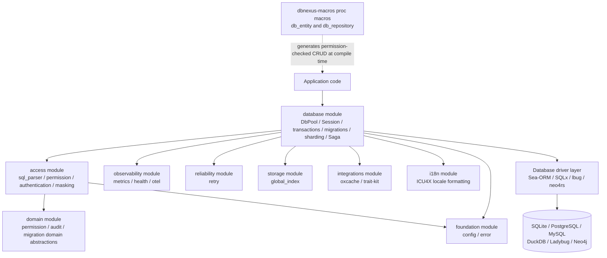
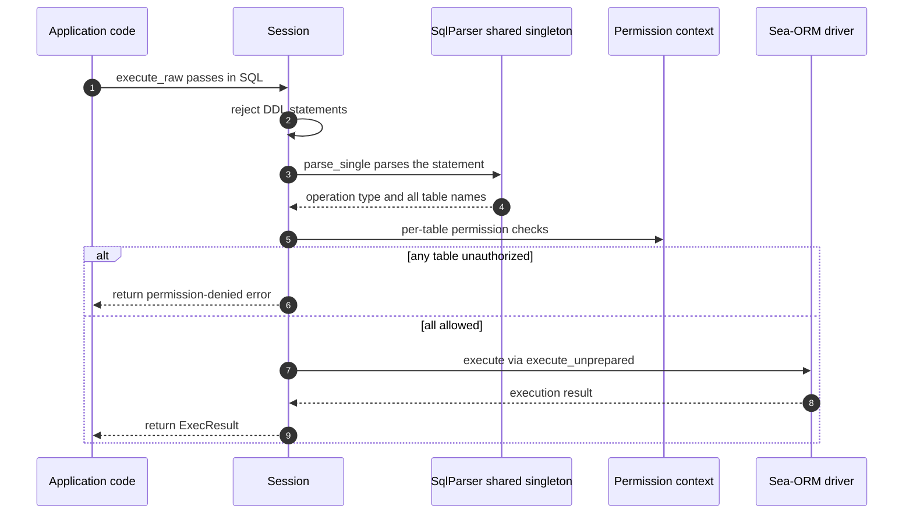
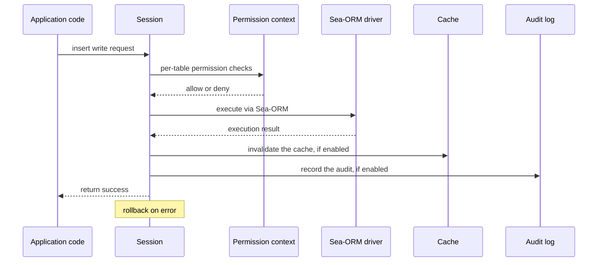
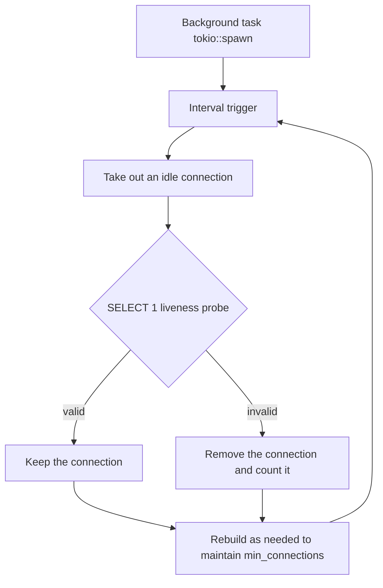
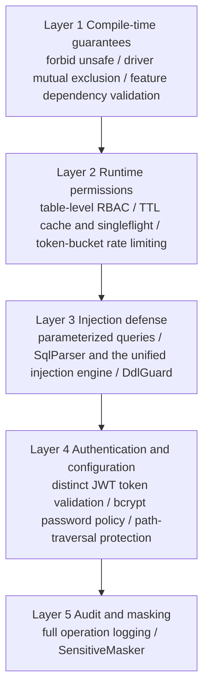
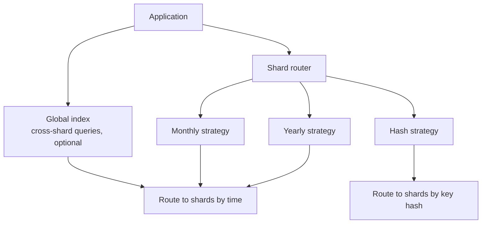
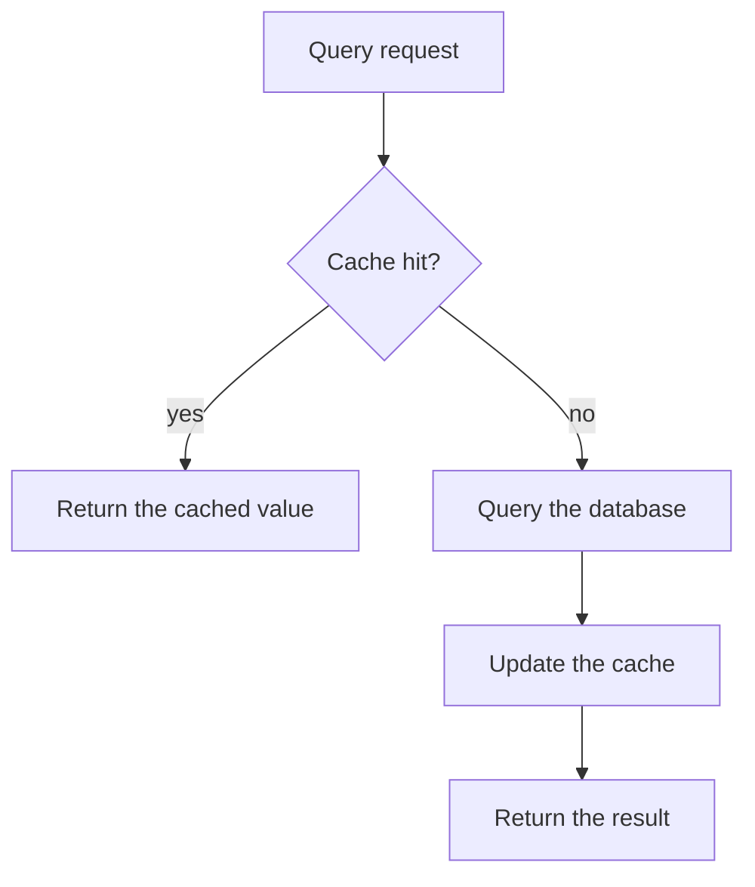

# 🏗️ Dbnexus Architecture Document

DBNexus is an enterprise-grade Rust database abstraction layer built on Sea-ORM. This document describes its design philosophy, system architecture, module breakdown, data flow, and security and performance design.

> Related documents: [📖 User Guide](USER_GUIDE.md) ｜ [📘 API Reference](API_REFERENCE.md) ｜ [🔒 Security](SECURITY.md) ｜ [📊 Performance Baseline](PERFORMANCE.md)

## 📋 Table of Contents

<details open>
<summary>📑 Table of Contents</summary>

- [Overview](#overview)
- [Design Principles](#design-principles)
- [System Architecture](#system-architecture)
- [Module Breakdown](#module-breakdown)
- [Core Execution Pipeline](#core-execution-pipeline)
- [Security Architecture](#security-architecture)
- [Performance Architecture](#performance-architecture)
- [Scalability Architecture](#scalability-architecture)
- [Summary](#summary)

</details>

---

## Overview

DBNexus's architecture follows a **layered design** with a clear separation of concerns, allowing developers to select exactly the features they need via feature gating.

**Key architectural goals**:

1. **Modularity** — feature-gated compilation for minimal binaries
2. **Security** — RAII-based resource management and compile-time guarantees
3. **Performance** — async-first design and an efficient connection pool
4. **Scalability** — pluggable components (permission engine, cache strategies, DDL guard)
5. **Observability** — built-in metrics and audit logging (optional features)

---

## Design Principles

### 1. RAII Resource Management

All database connections are managed with Rust's RAII (Resource Acquisition Is Initialization) pattern:

```rust
{
    let session = pool.get_session("admin").await?;
    // Use the session...
    // When the session is dropped, the connection is automatically returned to the pool
}
```

**Benefits**: automatic connection cleanup, no manual resource management, exception-safety guarantees.

### 2. Feature-Gated Architecture

Features are organized into logical groups and enabled at compile time (for the full feature table, see [User Guide · Feature Flags Reference](USER_GUIDE.md#feature-flags-reference)):

**Core foundation (always available)**: RAII connection pool, basic configuration management, ICU4X internationalized formatting.

**Core optional features (the `default-no-db` aggregate)**: `permission` (RBAC permissions), `sql-parser` (SQL parsing and injection detection), `macros` (procedural macros), `config-env` (environment variable configuration).

**Enterprise features (optional)**: `metrics`, `audit`, `migration`, `sharding`, `cache`, `authentication`, `health-check`, `permission-engine`, `global-index`, `ladybug`, `neo4j`, `kit`, and more.

**Feature dependencies (enforced at compile time)**:

| Feature | Dependencies | Reason |
|------|------|------|
| `permission` | `sql-parser` (mandatory), `dashmap`, `futures`, `yaml`, `arc-swap`, `cache` | Prevents SQL injection from bypassing permission checks; dashmap for the concurrent permission context, yaml for policy parsing, arc-swap for lock-free config reads, cache for the permission policy cache |
| `sql-parser` | `sqlparser`, `regex`, `unicode-normalization`, `oxcache/memory` | The parse-result cache (the prepare_cache port) is backed by the oxcache memory backend; does not imply the dbnexus `cache` feature |
| `permission-engine` | `permission`, `cache`, `dashmap`, `futures`, `regex` | The advanced permission engine needs the base permission types, cached policy decisions, and concurrency support |

> These dependencies are enforced via `compile_error!` macros in `src/lib.rs`; a missing dependency fails the build. Mixing database drivers (embedded and server-side) likewise fails at compile time, with no escape hatch.

### 3. Async-First Design

All I/O operations are based on Tokio's `async/await`:

- `RwLock` for shared state that is read-heavy and write-light (e.g. the internal state of `Session`); `Mutex` for write-heavy paths (e.g. the graph-operation mutex `graph_op_mutex`)
- `Notify` for conditional waiting on connection availability; `Semaphore` for concurrency limits
- `tokio::spawn` for background tasks (permission-cache hot reload, Outbox dispatch, etc.)

### 4. Type-Safe Abstractions

Compile-time guarantees prevent common mistakes:

- **Database driver mutual exclusion**: mixing embedded (`sqlite`/`duckdb`) and server-side (`postgres`/`mysql`) drivers fails the build outright
- **Feature dependency validation**: `permission` / `sql-parser` / `permission-engine` fail the build when required dependencies are missing, with no silent degradation
- **Type safety**: entity operations are generated by the `#[db_entity]` macro, with primary-key types genericized

---

## System Architecture

DBNexus's module panorama and dependency directions:



**Component interaction flow**:

1. The application requests a session with a specific role from `DbPool`
2. `DbPool` validates the role and creates a `Session` holding a database connection
3. `Session` handles all database operations with per-table permission checks
4. The permission system validates table access against role policies (with a TTL cache and rate limiting)
5. The connection is automatically returned to the pool when the session is dropped

**Key implementation details**:

- **Connection pool**: `RwLock` + atomic counters manage connection state; `Notify` wakes waiters
- **Permission cache**: TTL cache + singleflight request coalescing; the permission config is read lock-free via `ArcSwap`
- **Health checks**: a background task periodically validates idle connections (`pool-health-check` feature)
- **RAII management**: connections return to the pool automatically when sessions are dropped

---

## Module Breakdown

DBNexus uses a layered module design; each layer has clear responsibilities, and all layers are declared and exported via `src/lib.rs`.

### Top level

| Module | Responsibility |
|------|------|
| `lib.rs` | module declarations, compile-time feature mutual-exclusion checks, public API exports |
| `error.rs` | `DbNexusError`, `ErrorCode`, `UnifiedDbError`, `QueryErrorReport` (top-level unified error system) |
| `tools/cli/` | the `dbnexus-cli` ops CLI (`create` / `up` / `down` / `status` / `test-connection` / `generate` / `list` / `migrate` / `health` / `user` / `pool-status` / `audit-query` / `shard-info` / `permission-check` subcommands, most feature-gated) |

### Common types layer `common/`

Zero-dependency base types shared by all layers.

### Foundation layer `foundation/`

Infrastructure for configuration and error handling, with no business logic:

- `foundation/config/` — configuration system (`DbConfig`, `CacheConfig`, `PoolConfig`, `DatabaseType`, `ConfigError`; pure data structures deserialized via serde)
- `foundation/error/` — sub-error types (`DbError`, `AuditError`, `MigrationError`, etc.)

### Domain layer `domain/`

Business domain interfaces and data models:

- `domain/audit/` — the audit domain (`AuditLogger`, `AuditEvent`, `AuditStorage` plus in-memory/database storage implementations, cfg = `audit`)
- `domain/migration/` — the migration domain: base modules such as `schema.rs` are always available (used by the `schema()` method generated for `#[db_entity]`); execution modules such as `executor.rs` and `differ.rs` have cfg = `migration`
- `domain/permission/` — permission domain interfaces (`PermissionProvider`, `PermissionChecker`, `PolicyManager` traits and configuration types, cfg = `permission`)
- `domain/cache_provider.rs` — the `DbCacheProvider` cache abstraction trait

### Database layer `database/`

Database connections, sessions, and the data plane:

| Module | Responsibility | Gate |
|------|------|------|
| `pool/db_pool/` | `DbPool` (three parts: `access` / `health` / `status`), `PoolStatus` | core |
| `pool/session/` | `Session` (RAII session hosting transactions, permission checks, slow-query timing, graph-operation mutexing; split by responsibility into execute/transaction/duckdb/graph/metrics submodules) | core |
| `pool/pool_impl.rs` | connection pool internals (atomic counters + `Notify` + `Semaphore`) | core |
| `pool/prepare_cache.rs` | statement-level prepared statement LRU cache | `prepare-cache` |
| `pool/health_export.rs` | `health_snapshot` structured health export | `health-check` |
| `pool/audit.rs` | security auditing (auditing of admin bypass operations) | `audit` |
| `pool/duckdb_conn.rs` | `DuckDbConnection` (pooled, bridged via spawn_blocking) | `duckdb` |
| `graph/` | `GraphConnection` trait, `LadybugConnection`, `Neo4jConnection`, graph transactions | `ladybug` / `neo4j` |
| `sharding.rs` | `ShardRouter`, sharding strategies (yearly / monthly / daily / hash / consistent-hash) | `sharding` |
| `scatter.rs` | cross-shard Scatter-Gather query executor | `scatter-gather` |
| `saga/` | Saga distributed transaction orchestrator (SagaLog persistence + startup recovery) | `saga` |
| `replica.rs` | replica-routing read/write splitting (weight- and latency-aware selection) | `replica-routing` |
| `migration/` | runtime migration executor | `migration` |
| `repository.rs` | `Repository<T>` CRUD port + the `JsonRepository` reference implementation | `repository` |
| `data_api.rs` | `DataApiGateway` entity-to-JSON query endpoint generator | `data-api` |
| `entity_events.rs` | entity event bus + Outbox persistent dispatch | `entity-events` |
| `query_dsl.rs` | `q!` type-safe query fragment macro | `query-dsl` |
| `copy.rs` | COPY FROM STDIN statement building and text row encoding | `copy` |
| `config_confers.rs` | confers hot config reload (atomic `ArcSwap` swap) | `config-confers` |

### Access layer `access/`

Permission control, security checks, authentication:

| Module | Responsibility | Gate |
|------|------|------|
| `permission/` | runtime RBAC: `PermissionContext` (cache + rate limiting + stampede protection), `PermissionCache`, `RateLimiter`, `RbacProvider`, etc. | `permission` |
| `sql_parser.rs` | `SqlParser` (operation type and table-name extraction), `is_ddl_operation`, `contains_sql_injection` | `sql-parser` |
| `injection_engine.rs` | the `InjectionEngine` unified injection detection engine (a single registry for relational / DDL / graph) | `sql-parser` |
| `security/ddl_guard.rs` | `DdlGuard` (AST validation), the `DdlGuardPolicy` port and audit/dry-run decorators | `sql-parser` |
| `security/sensitive.rs` | `SensitiveMasker` data masking | core |
| `security/posture.rs` | `security_posture` compile-time feature posture aggregation | core |
| `authentication/` | `AuthenticationManager`, `JwtManager`, `PasswordHasher` | `authentication` |
| `permission_engine.rs` | `PolicyDecisionPoint` (RBAC + ABAC policy decision point) | `permission-engine` |
| `permission_facade.rs` | the `PermissionFacade` unified permission facade (RBAC + masking + RLS combined swap) | `permission-facade` |
| `permission_audit_chain.rs` | permission-change audit chain (HMAC-SHA256 chain signatures + tamper detection) | `audit` |
| `data_protection.rs` | field-level automatic masking (mask / hash / truncate) and row-level security predicate injection | `data-protection` |

#### Note on the Two Permission Implementations

The project has two permission implementations with a clear division of labor:

- **`domain/permission/`** — the permission **domain interface layer**, providing trait definitions (`PermissionProvider`, `PermissionChecker`, `PolicyManager`, `PermissionLifecycle`) and configuration types. For scenarios that only need interfaces or configuration types.
- **`access/permission/`** — the permission **runtime implementation layer**, providing runtime capabilities such as `PermissionContext` (cache + rate limiting + cache-stampede protection), `RateLimiter`, `RbacProvider`. For scenarios that need a runtime context/cache/rate limiting.

The two layers coexist complementarily; this is not a "deprecated" relationship.

### Observability layer `observability/`

- `observability/metrics.rs` — `MetricsCollector` (Prometheus export, query latency percentiles, slow-query detection, cfg = `metrics`)
- `observability/health.rs` — `HealthChecker`, `CircuitBreaker` (cfg = `health-check`)

### Reliability layer `reliability/`

- `reliability/retry.rs` — `RetryPolicy`, `RetryExecutor` (runtime retries + exponential backoff; only idempotent queries retry automatically, cfg = `retry`)

### Storage layer `storage/`

- `storage/global_index.rs` — the `GlobalIndex` cross-shard global index (cfg = `global-index`)

### Integrations layer `integrations/`

- `integrations/kit/` — `DbNexusModule` and the cache/audit/health satellite modules (cfg = `kit`, trait-kit AsyncKit integration)
- `integrations/oxcache_adapter.rs` — `OxcacheDbCacheAdapter` (cfg = `oxcache-integration`)
- `integrations/http_health.rs` — the `HealthRouterBuilder` three-endpoint health Router: /healthz /readyz /metrics (cfg = `http-health`, generates an axum Router rather than a server)

> Adapter-direction convention: oxcache/trait-kit do not depend on dbnexus, and the adapters reside in dbnexus
> — consumers can thereby avoid cycles. External components that depend back on dbnexus (both limiteron and inklog
> optionally depend on dbnexus as a storage/audit backend) cannot follow this pattern — a reverse dependency from dbnexus
> would form a cycle (inklog's caret requirement would match newer dbnexus versions, forming a package-level cycle);
> such cases must extract a standalone port crate or house the adapter on the other side:
> the `Limiter` port lives in the workspace member `limiter-port/` (`dbnexus-limiter-port`,
> depending only on async-trait, on neither dbnexus nor limiteron); the token-bucket implementation of the port is the default rate-limiting backend, and external backends are injected via the application composition root.
> See `docs/en/RATE_LIMITING.md` for details.

### Internationalization module `i18n/`

- `i18n/i18n_impl.rs` — `DbI18nFormatter` (ICU4X locale-aware formatting; a core feature, always available)

---

## Core Execution Pipeline

Under `data-protection`, both the raw SQL gate and the row-read gate route RLS through `RlsEngine::decide`, a single decision point that yields `Passthrough` / `OutOfScope` / `Inject` / `InjectDegraded` / `Reject`; degraded JOINs inject the predicate into the primary table only and emit an `rls_degraded` audit event.

### Procedural Macro System

`#[db_entity]` generates permission-checked CRUD methods at compile time (for the full table of generated methods, see [API Reference](API_REFERENCE.md#db_entity)):

**Input**:

```rust
#[db_entity(table_name = "users", primary_key = "id")]
#[derive(Clone, Debug, PartialEq, DeriveEntityModel)]
#[sea_orm(table_name = "users")]
struct Model {
    #[sea_orm(primary_key)]
    id: i64,
    name: String,
}
```

**Generated code (simplified)**:

```rust
impl Model {
    pub async fn insert(session: &Session, value: Model) -> DbResult<Model> { /* ... */ }
    pub async fn find_by_id<PK>(session: &Session, pk: PK) -> DbResult<Option<Model>>
    where
        PK: Into<<<Entity as sea_orm::EntityTrait>::PrimaryKey as sea_orm::entity::prelude::PrimaryKeyTrait>::ValueType>
    { /* ... */ }
    pub async fn find_all(session: &Session) -> DbResult<Vec<Model>> { /* ... */ }
    // update / delete / delete_many / count / exists / find_by_ids ...

    pub fn table_name() -> &'static str { "users" }
    pub fn primary_key_column() -> &'static str { "id" }
}
```

### Query Flow

The real execution pipeline of `Session::execute_raw` (with the `sql-parser` + `permission` feature combination):



Path notes:

- **Safe default on parse failure**: the admin role is allowed, non-admin roles are denied, with no silent degradation
- **Full cross-table coverage**: every target table in JOINs / subqueries goes through permission checks one by one
- **Idempotent automatic retries**: under the `retry` feature, idempotent statements such as SELECT retry with exponential backoff after failures
- **Slow-query observability**: under the `metrics` feature, execution time is recorded and automatically captured by `MetricsCollector` when above the threshold

### Write Flow (with cache and audit)



### Health-Check Loop (the `pool-health-check` feature)



---

## Security Architecture

Defense-in-depth is organized into five layers from the bottom up; for the detailed mechanisms of each layer, see the [Security document](SECURITY.md#-security-design-overview):



**Permission-check algorithm** (`PermissionContext::check_table_access`):

1. Get the role from the session
2. Look up the role's policy (with a TTL cache + singleflight coalescing)
3. If the wildcard table `"*"` matches, grant all access
4. Otherwise check the action list of that table (SELECT / INSERT / UPDATE / DELETE, etc.)
5. Return allowed or denied; every check is constrained by token-bucket rate limiting

---

## Performance Architecture

### Zero-Cost Feature Gating

Optional capabilities are trimmed at compile time via `#[cfg(feature = ...)]`; when not enabled, they cost nothing. Take `Session::record_metric` as an example — the entire method body compiles only under the `metrics` feature:

```rust
#[cfg(feature = "metrics")]
pub fn record_metric(&self, operation: &str, table_name: &str, success: bool) { /* ... */ }
```

### Lock-Free Hot Paths

- The connection pool counters (`active_count`, `wait_count`, `borrow_count`, etc.) are all `AtomicU32` / `AtomicU64`; the snapshot type `PoolStatus` returns plain integers
- The permission config and cache provider are read lock-free via `ArcSwap` (COW mode)
- Atomic operations use `AcqRel` / `Relaxed` memory orderings to reduce unnecessary global synchronization overhead

### Async and Lock Strategy

- All I/O uses `async/await`
- `RwLock` for shared state that is read-heavy and write-light (the internal state of `Session`), allowing concurrent reads
- `Mutex` only for write-heavy paths (the graph-operation mutex)
- `Notify` instead of condition variables (avoiding busy waiting)

### Connection Pool Strategy

| Strategy | Notes |
|------|------|
| Connection reuse | avoids TCP handshake overhead |
| Max-connection limit | prevents connection exhaustion; waiters beyond the limit are woken via `Notify` |
| Minimum-connection maintenance | pre-warms connections, avoiding cold starts |
| Health checks | remove dead connections and rebuild as needed |

For benchmark data and reproduction commands, see the [Performance Baseline](PERFORMANCE.md).

---

## Scalability Architecture

### Horizontal Scaling (Sharding)



### Vertical Scaling (Cache)



---

## Summary

DBNexus's architecture delivers:

1. **Modularity** — a clear separation of concerns with feature gating
2. **Security** — RAII, compile-time guarantees, crate-wide unsafe forbidden, multi-layer defense-in-depth
3. **Performance** — async-first, lock-free hot paths, efficient pooling
4. **Scalability** — pluggable components, trait-based design
5. **Observability** — metrics, health checks, built-in audit logging

This architecture lets DBNexus scale from embedded devices to enterprise deployments while staying simple and ergonomic.

For more component details, see:

- [📘 API Reference](API_REFERENCE.md)
- [📖 User Guide](USER_GUIDE.md)
- [🔒 Security](SECURITY.md)
- [📦 Online API docs](https://docs.rs/dbnexus)
