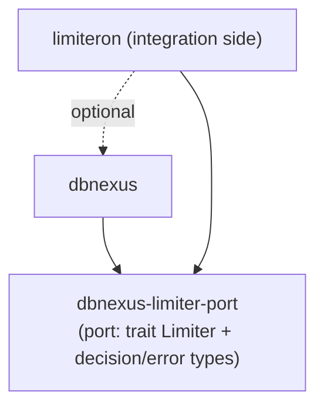

# Unified Rate Limiting Migration Guide (Limiter Port / limiteron Backend)

> Applies to: dbnexus 0.6.0-rc.9+ (R-dbnexus-003 rate-limiting unification)

## Background

dbnexus's permission-check chain (`PermissionContext::check_table_access`) has a built-in
token-bucket rate limiter (`RateLimiter`). The roadmap calls for integrating limiteron as an
optional rate-limiting backend, but there is a hard constraint:

- limiteron already **optionally depends on dbnexus** (its `postgres`/`sqlite`/`mysql` storage
  features persist quotas/bans through dbnexus drivers);
- Cargo **forbids package-level circular dependencies (optional included)** — once dbnexus
  depends back on limiteron (directly or transitively through any intermediate crate), any
  combination enabling a limiteron storage feature would form a cycle.

Therefore the only viable path is **layer/port extraction**: the rate-limiting port `Limiter`
becomes a small standalone crate, `dbnexus-limiter-port` (`limiter-port/` in this repository;
it depends only on `async-trait`, and on neither dbnexus nor limiteron).
dbnexus and limiteron each depend on the port one-way, and the assembly happens at the
application composition root:



> Dashed line: limiteron's existing storage dependency (direction unchanged).

Verified by full-graph resolution (`cargo metadata` cycle detection): no dependency cycle
involving dbnexus or dbnexus-limiter-port exists.

## Port Contract

```rust
#[async_trait]
pub trait Limiter: Send + Sync {
    /// Check whether the key (role/user/IP) is allowed through, consuming one unit of quota
    async fn check(&self, key: &str) -> Result<RateLimitDecision, RateLimitError>;
}

pub struct RateLimitDecision {
    pub allowed: bool,
    /// HTTP 429 Retry-After semantics; None = not provided by the backend
    pub retry_after: Option<Duration>,
}
```

- `async_trait` guarantees object safety, so `Arc<dyn Limiter>` can be injected (consistent
  with the async_trait pattern of limiteron's own `limiters::Limiter`);
- backend failures are reported explicitly via `Err(RateLimitError)`; the port never allows
  or denies on its own.

## Dual-Backend Switching

`PermissionContext::with_cache_size_and_backend` is the backend selection entry point:

```rust
use dbnexus::access::{PermissionContext, RateLimitBackend};

// 1. Built-in token bucket (default backend; behavior identical to 0.6.0-rc.5)
let ctx = PermissionContext::with_cache_size_and_backend(
    "admin".into(), 4096,
    RateLimitBackend::TokenBucket { max_requests: 100, window_secs: 60 },
).await?;

// 2. External port implementation injection (e.g. a limiteron adapter)
let ctx = PermissionContext::with_cache_size_and_backend(
    "admin".into(), 4096,
    RateLimitBackend::External(Arc::new(my_limiteron_adapter)),
).await?;
```

Existing constructors (`new_default_with_rate_limit`, `with_cache_size_and_rate_limit`, etc.)
behave unchanged — the token bucket is still assembled by default.

### Wiring a limiteron Adapter (Composition-Root Example)

dbnexus does not depend on limiteron directly (cycle prevention). On the limiteron side, a
`limiteron-dbnexus` integration crate implementing the port may be published in the future,
following the pattern of its `integrations/limiteron-sdforge`; until then, the application
composition root can write a thin adapter itself:

```rust,ignore
struct LimiteronAdapter { limiter: limiteron::limiters::TokenBucket }

#[async_trait]
impl dbnexus::Limiter for LimiteronAdapter {
    async fn check(&self, key: &str) -> Result<RateLimitDecision, RateLimitError> {
        self.limiter
            .allow(key, 1).await
            .map(|allowed| if allowed { RateLimitDecision::allow() }
                            else { RateLimitDecision::deny(None) })
            .map_err(|e| RateLimitError::new(e.to_string()))
    }
}
```

## 429 Response Semantics

A rate-limit denial and a policy denial of the permission check were previously
indistinguishable (both `false`). Now `TableAccessDecision` is introduced:

- `Allowed` — allowed;
- `Denied` — policy denial (403 semantics);
- `RateLimited { retry_after }` — rate-limit denial (429 semantics, carrying a Retry-After suggestion).

The session layer (`Session::check_permission` and all execution paths) maps through the
unified `check_table_or_error`: `Denied → DbError::Permission` (unchanged),
`RateLimited → DbError::RateLimited { retry_after_secs }`. The HTTP layer can map
`DbError::RateLimited` to 429 + the `Retry-After` response header; the unified error code
is `ErrorCode::RateLimited = 2002`.

The legacy boolean API `check_table_access` is preserved: both denial kinds return `false`,
behavior compatible.

### Failure Semantics

When the rate-limiting backend's `check` returns `Err`, the behavior is **fail-closed**:
treated as a rate-limit denial (counted in the `rate_limited_checks` statistics + explicitly
logged via `log::warn`), never silently allowed; `retry_after = None` in that case.

## Audit Events

Under the `audit` feature, an auditor can be attached to the context; a rate-limit denial
then produces an audit event:

```rust,ignore
let mut ctx = PermissionContext::with_cache_size_and_backend(/* ... */).await?;
ctx.set_audit_logger(Arc::new(audit_logger));
```

Event shape: `entity_type = "table_access"`, `entity_id = table name`,
`operation = rate_limit_exceeded`, `result = Failure`, `severity = Medium`;
the `extra` JSON carries `operation` (the SQL action) and `retry_after_secs`. Audit write
failures do not block the permission decision but are explicitly logged via `log::warn`.

## Features and Dependencies

- New workspace member `limiter-port` (crate name `dbnexus-limiter-port`, zero features,
  `async-trait` only);
- the `permission` feature gains `dep:dbnexus-limiter-port` (the port is available with the
  permission module; without `permission` enabled there are zero extra dependencies);
- the legacy token bucket remains the default optional backend; no public API was removed.

## Migrating from 0.6.0-rc.5

| Scenario | rc.5 | rc.6+ | Action |
| --- | --- | --- | --- |
| Default token-bucket rate limiting | auto-assembled | auto-assembled (unchanged) | none |
| Adjusting token-bucket parameters | `with_cache_size_and_rate_limit` | unchanged | none |
| Integrating limiteron or other external backends | infeasible (would form a cycle) | `with_cache_size_and_backend` + `External(Arc<dyn Limiter>)` | implement the port, then inject |
| Distinguishing 429/403 | indistinguishable (both `false`) | `check_table_access_decision` | the session layer already returns `DbError::RateLimited` automatically |
| Rate-limit auditing | none | `set_audit_logger` (audit feature) | attach as needed |
